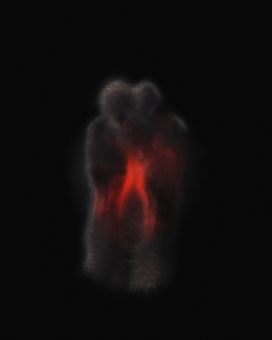
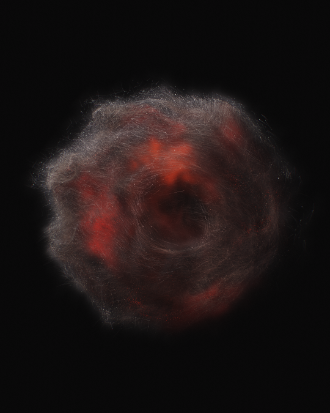
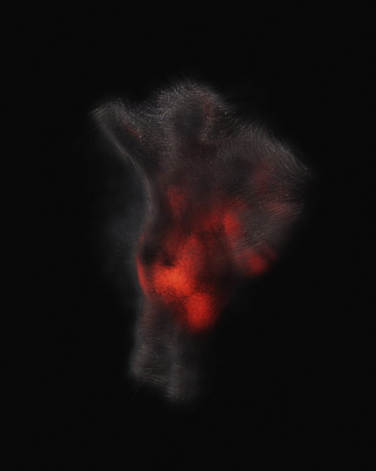

# Resonant Dust

A cloud of smoke and fire that dances to music. A million particles, simulated on the GPU, gather into hidden figures (dancers, a kissing pair, wings, a hand) and breathe, roll and flare with the sound.

| Eye | Dancer |
|---|---|
|  |  |

## Run it

Open `index.html` in Chrome. It runs offline, since three.js and the video muxer are in `lib/`. Then:

- **▶ Demo beat**, **Load audio file** (mp3, m4a, wav, mp4) or **Microphone**
- Drag to orbit, scroll to zoom, press **H** to hide the interface
- **Tweak**: fire, smoke, wind, particle count (262k to 2M), depth of field, trails

## Export a film

**Tweak → Export film**. The piece renders your track frame by frame, at up to 4K, so every frame is perfect even at 2M particles. It encodes to MP4 with WebCodecs (H.264, plus AAC when the browser supports it).

## How it works

- **Simulation:** a GPGPU ping-pong simulation (position + life, velocity + seed). Each particle springs toward a home on nested skins of a hidden signed-distance figure. Slow curl-noise wind and a continuous rolling flow move it, and the music drives the speed of that flow.
- **Smoke:** every frame the particles are splatted into a 3D density grid. Each pixel ray-marches through it, lit by a cold key light and by the inner fire, with the smoke shadowing itself.
- **Fire:** an emission that lives in the dense core of the smoke, so you see it through the smoke in front of it.
- **Audio:** FFT bands (bass, mids, highs), spectral-flux kick detection, and quiet/drop detection that changes the choreography.
- **Post:** HDR bloom pyramid, light shafts, ACES tone mapping and film grain.

Built with [three.js](https://threejs.org) r128 and [mp4-muxer](https://github.com/Vanilagy/mp4-muxer) 5.1.3, both MIT-licensed.

Inspired by the generative smoke work of incrprl.dsgn.
